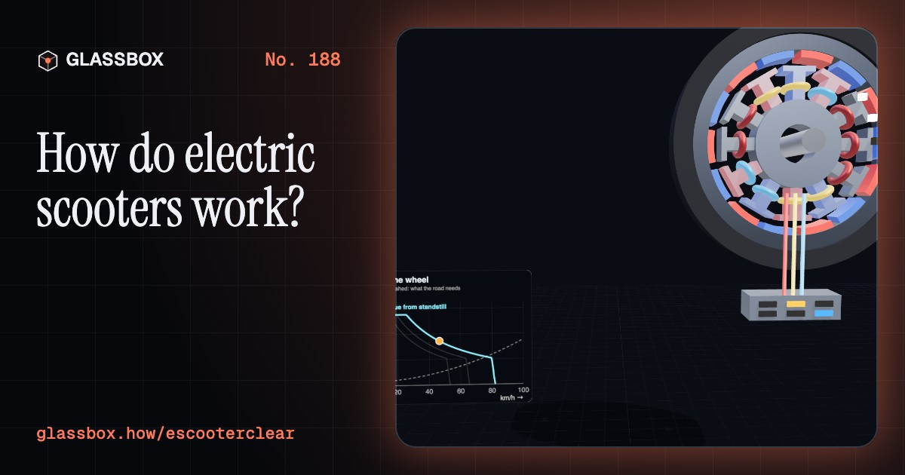
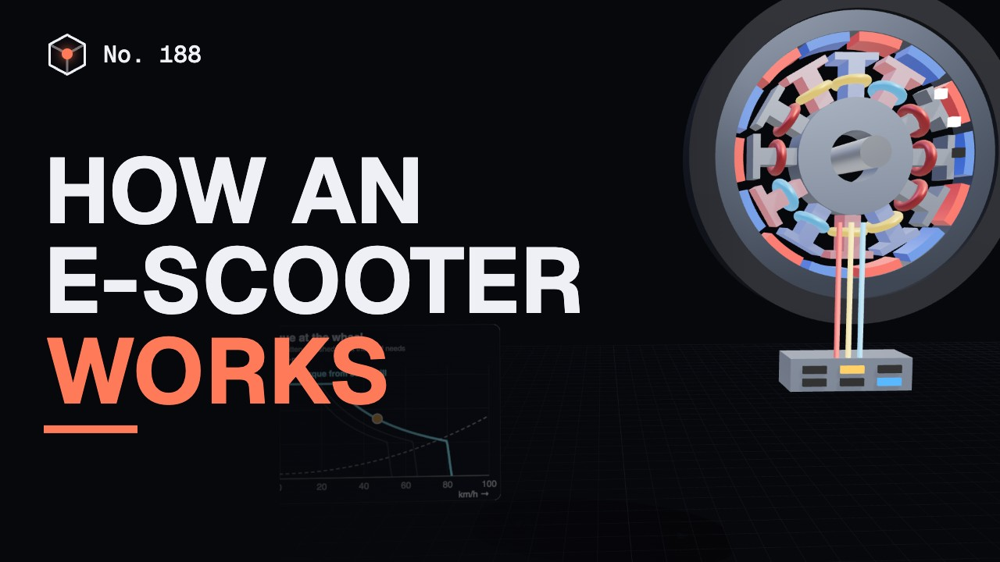
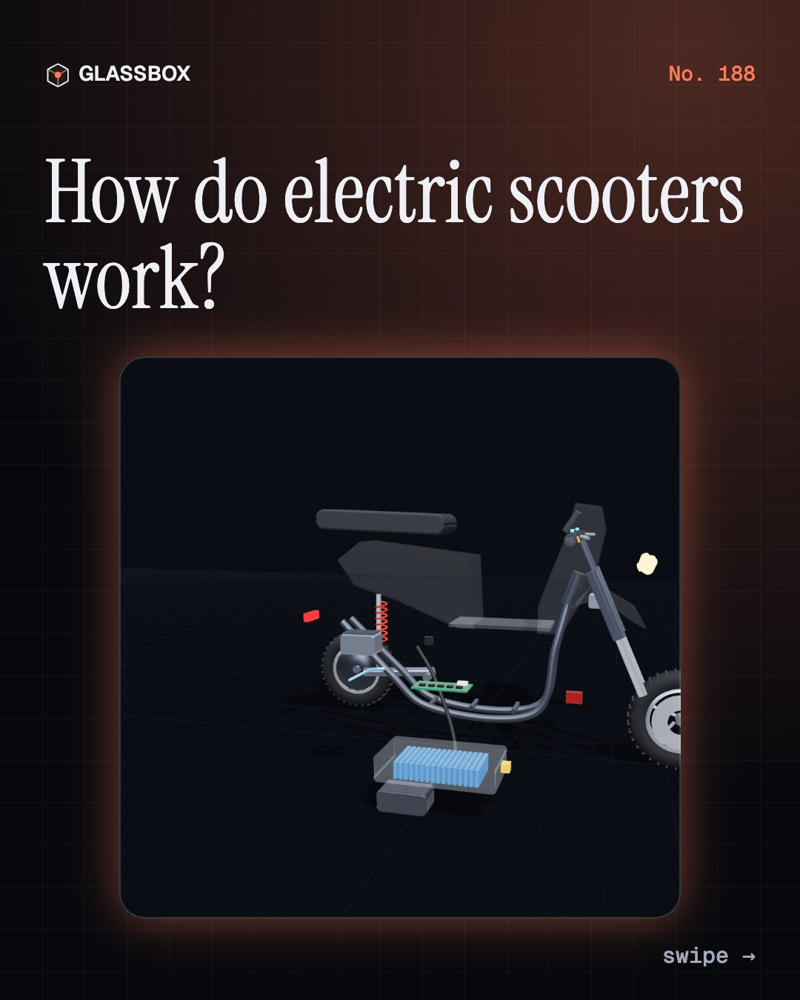
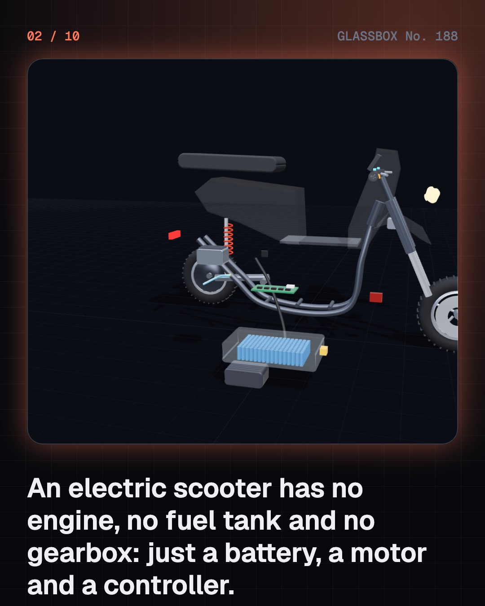
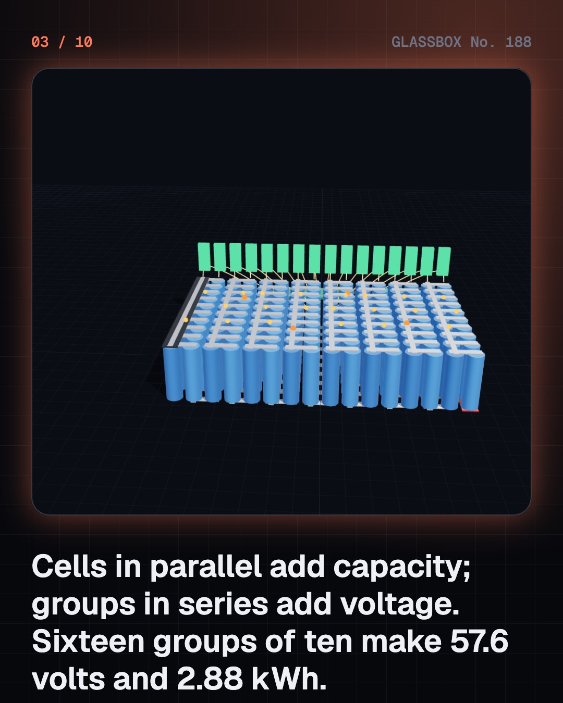
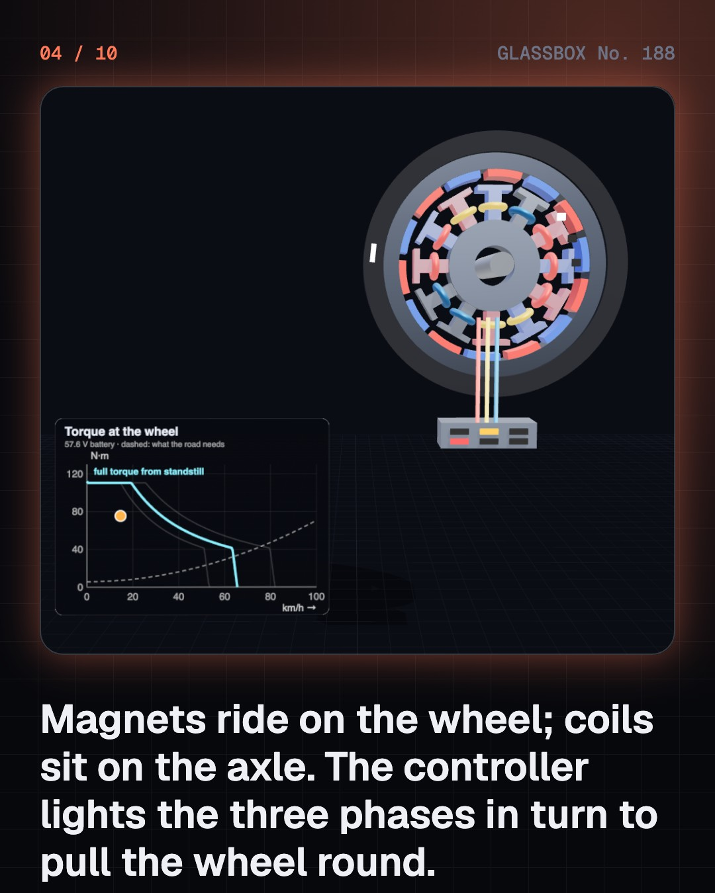

<!-- glassbox:start -->
<!-- Generated from glassbox.json by the Glassbox hub (npm run readme -- escooterclear). Edit glassbox.json, not this block. -->
<p align="center"><a href="https://glassbox.how/e/escooterclear/"></a></p>

<h1 align="center">EScooterClear</h1>

<p align="center"><b>How do electric scooters work?</b><br>An electric scooter has no engine, no gears and no clutch: just 160 finger-sized cells, a motor hidden inside the back wheel, and a box of switches that flips its coils hundreds of times a second. Take one apart in 3D and see why it costs a few paise per kilometre.</p>

<p align="center"><a href="https://glassbox.how/escooterclear/"><b>▶ Play with it</b></a> &nbsp;·&nbsp; <a href="https://glassbox.how/e/escooterclear/">Read the 60-second explainer</a> &nbsp;·&nbsp; <a href="https://glassbox.how/escooterclear/glassbox/reel.mp4">Watch the 40-second video</a></p>

<p align="center">
  <a href="https://glassbox.how/e/escooterclear/"></a>
  <a href="https://glassbox.how/e/escooterclear/"></a>
  <a href="LICENSE"></a>
  <a href="LICENSE-CONTENT.md"></a>
  <a href="#privacy"></a>
</p>

## In 60 seconds

1. **Three parts do the work.** A battery pack under the floor, a motor built into the rear wheel, and a controller that links them. There is no engine, fuel tank, gearbox, clutch or exhaust. Brake levers carry cut-off switches, a DC-DC converter makes 12 V for the lights, and a charger turns mains AC into DC for the cells.
2. **Cells in series and parallel.** One lithium-ion cell gives about 3.6 V. Ten side by side make a 50 Ah group; sixteen groups in a chain make 57.6 V. That is 57.6 × 50 = 2,880 Wh, or 2.88 kWh. A battery management system watches every group, balances them and cuts the power if anything goes outside safe limits.
3. **Magnets on the wheel, coils on the axle.** The hub motor's drum carries magnets; the fixed stator carries three sets of coils. Hall sensors tell the controller where the magnets are, and it switches the phases in six steps so the coils always pull the wheel forward. Torque comes from current, so it is strongest from standstill. Top speed is set by voltage, where the motor's back-EMF catches up.
4. **Where the energy goes.** At 40 km/h the scooter needs about 19 Wh per km at the wheel: rolling resistance and, more and more with speed, air drag. About 26 Wh comes from the socket. A 110 cc petrol scooter uses roughly five times as much energy for the same kilometre, because most of its fuel leaves as heat.
5. **Braking back, charging in.** Slowing down, the motor works as a generator, but from 40 km/h the motion holds only about 3 Wh, so the friction brakes still do the real stopping. Charging runs at constant current, then constant voltage; the last 20% is slow because the current tapers.
6. **Safety first.** After scooter fires in 2022, India added tougher battery tests to the AIS-156 standard: smarter BMS, cell spacing, extra fuses, temperature sensors and an overheat warning. Use only the approved charger, in an earthed socket, in an open place, and never tamper with the BMS, fuses or speed limiter.

## Words worth knowing

| Term | Meaning |
|---|---|
| **Battery pack** | Many lithium-ion cells wired in series and parallel inside a sealed enclosure, with a BMS. |
| **BMS** | Battery management system: the circuit that measures every cell group, balances them and cuts the power on over-voltage, under-voltage, over-current or over-temperature. |
| **Hub motor** | A brushless motor built into a wheel: magnets on the turning drum, coils on the fixed axle. |
| **Controller** | Electronics that turn battery DC into three-phase current for the motor, as much as the throttle asks. |
| **Back-EMF** | The voltage a spinning motor generates. It rises with speed and limits how fast the battery can drive it. |
| **kWh** | Kilowatt-hour, a unit of energy: volts × amp-hours ÷ 1,000. A typical family e-scooter carries about 2.5–4 kWh. |
| **Wh per km** | Energy used per kilometre. Range is usable energy divided by this. |
| **Regenerative braking** | Using the motor as a generator to slow down and put some energy back into the battery. |
| **CC-CV charging** | Constant current until the cells reach full voltage, then constant voltage while the current tapers off. |

## A short history

**Two hundred years from Faraday's spinning wire to millions of Indian scooters with a motor in the back wheel.**

- **1821** · A wire that spins round a magnet (Michael Faraday, Royal Institution, London)
- **1895** · A motor inside the back wheel (Ogden Bolton Jr., Canton, Ohio)
- **1985** · The first lithium-ion cell (Akira Yoshino, Asahi Kasei, Kawasaki)
- **2015** · India's FAME scheme (Ministry of Heavy Industries, New Delhi)
- **2019** · Nobel Prize for the lithium-ion battery (John B. Goodenough, M. Stanley Whittingham, Akira Yoshino, Stockholm)
- **2022** · A string of scooter fires (Several makers' electric scooters, Pune, Vellore and other cities)
- **2022** · Tougher battery rules: AIS-156 (Ministry of Road Transport and Highways, New Delhi)
- **2024** · PM E-DRIVE (Union Cabinet, Ministry of Heavy Industries, New Delhi)

The full story, with 28 moments, charts, people and 28 sources: [glassbox.how/e/escooterclear/history](https://glassbox.how/e/escooterclear/history/). The data lives in [`history.json`](history.json).

## Video and slides

Made with the Glassbox studio from this box's storyboard (`window.glassbox.director`). Free to reuse under CC BY 4.0.

<a href="https://glassbox.how/escooterclear/glassbox/video.mp4"></a>

<p><a href="glassbox/slide-1.jpg"></a> <a href="glassbox/slide-2.jpg"></a> <a href="glassbox/slide-3.jpg"></a> <a href="glassbox/slide-4.jpg"></a></p>

| File | What | Size |
|---|---|---|
| [`glassbox/reel.mp4`](https://glassbox.how/escooterclear/glassbox/reel.mp4) | Reel / Short, with captions and soundtrack | 1080×1920 |
| [`glassbox/video.mp4`](https://glassbox.how/escooterclear/glassbox/video.mp4) | YouTube video, with captions and soundtrack | 1920×1080 |
| `glassbox/slide-1…10.jpg` | Instagram carousel | 1080×1350 |
| `glassbox/thumb.jpg` | YouTube thumbnail | 1280×720 |
| `glassbox/cover.jpg` | Share card and repo social preview | 1200×630 |
| [`glassbox/history-reel.mp4`](https://glassbox.how/escooterclear/glassbox/history-reel.mp4) | “History in 10 moments” Reel / Short | 1080×1920 |
| `glassbox/history-slide-*.jpg` | History carousel | 1080×1350 |
| `glassbox/post.json` | Post copy and schedule used by the publish kit | |

## Privacy

This box has no accounts and no ads, and it ships its own fonts and libraries. When you run it yourself it sends nothing anywhere. On glassbox.how, the site's `/bar.js` also loads Glassbox's analytics: **Google Analytics** to count visits (it asks first in the EU, UK and Switzerland, and stays off when your browser sends Global Privacy Control or Do Not Track) and **ClickTrust** to detect bots.

It remembers a few things **in your own browser only**, and never sends them anywhere:

| Browser storage key | What it holds |
|---|---|
| `escooterclear.v1` | Which chapters you have opened, your best quiz scores, and sound on or off. |

Exactly what each one sees is at [glassbox.how/privacy](https://glassbox.how/privacy/).

## Licences

- **Code:** [MIT](LICENSE). Use it, change it, ship it.
- **Explanations, text, images and videos** (`glassbox.json`, `glassbox/`): [CC BY 4.0](LICENSE-CONTENT.md). Credit “Glassbox, glassbox.how/e/escooterclear”.
- **Third-party parts** keep their own licences: [three.js](https://threejs.org) (MIT), [Geist, Instrument Serif](https://openfontlicense.org) (SIL OFL 1.1).
- The Glassbox name and logo aren't covered by either licence. See the [terms](https://glassbox.how/terms/).

Found a mistake? [Open an issue](https://github.com/bdeeps/escooterclear/issues). Corrections happen in public.
<!-- glassbox:end -->

## Run it

It's plain HTML, CSS and JavaScript. No build step and no dependencies. Run locally, it contacts no other website.

```bash
python3 -m http.server 8000
```

Three.js and the fonts ship in `vendor/` and `fonts/`, so it also works offline.

Then open http://localhost:8000.

## How it's built

| File | What |
|---|---|
| `index.html`, `css/app.css` | The page and its styles |
| `js/app.js`, `js/stage.js`, `js/ui.js`, `js/kit.js` | The shared Glassbox 3D engine: chapters, 3D stage, controls, quiz, video director |
| `js/chapters/*.js` | One file per chapter: the 3D model, controls, text, key terms, quiz and video scenes |
| `js/scooter.js` | The shared models and physics: a generic seated e-scooter and kick scooter, cells and packs, the hub-motor model, road load, range, a petrol-scooter comparison, regenerative braking and CC-CV charging |
| `glassbox.json` | Title, question, explainer beats, key terms, browser storage and credits shown on glassbox.how |
| `reel` in each chapter | The storyboard the Glassbox studio records into short videos |
| `glassbox/` | The published video, slides, thumbnail and post copy |
| `fonts/`, `vendor/three/` | Self-hosted Geist and Instrument Serif (SIL OFL 1.1) and three.js (MIT) |
